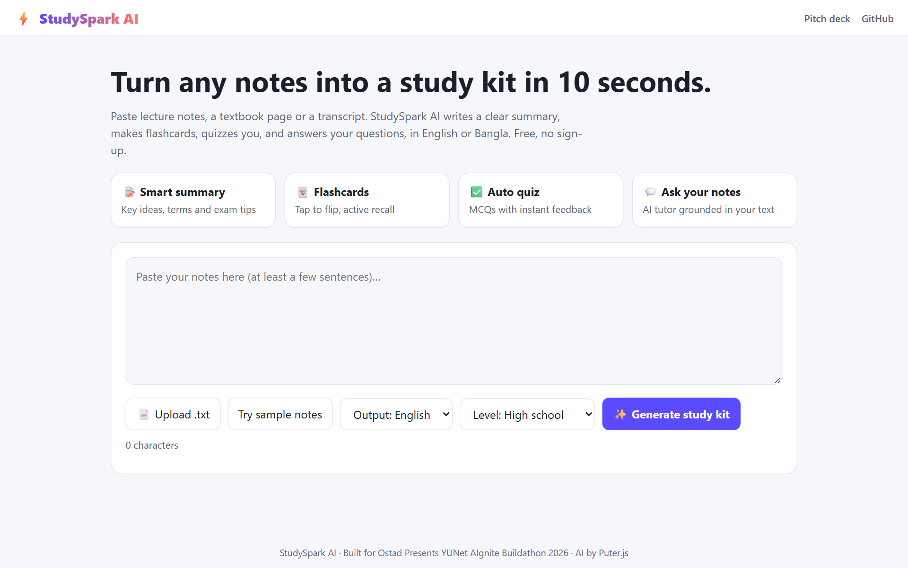
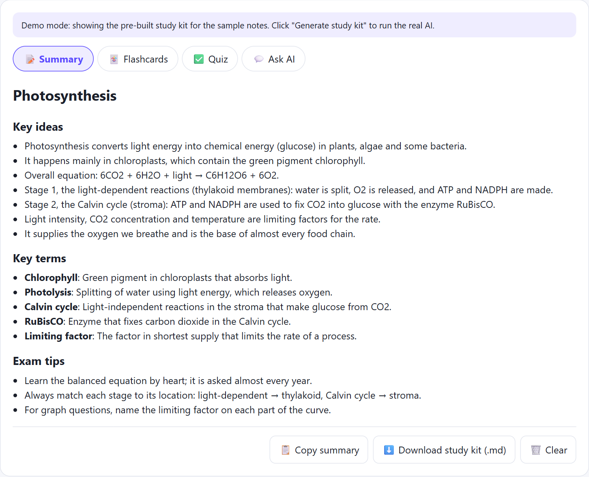
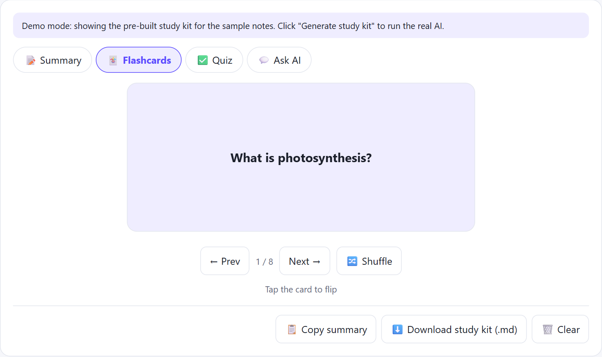
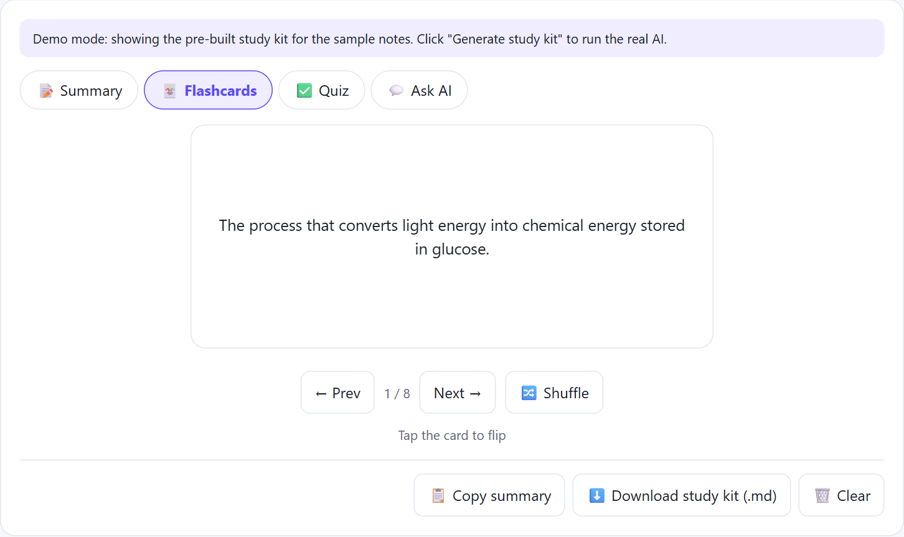
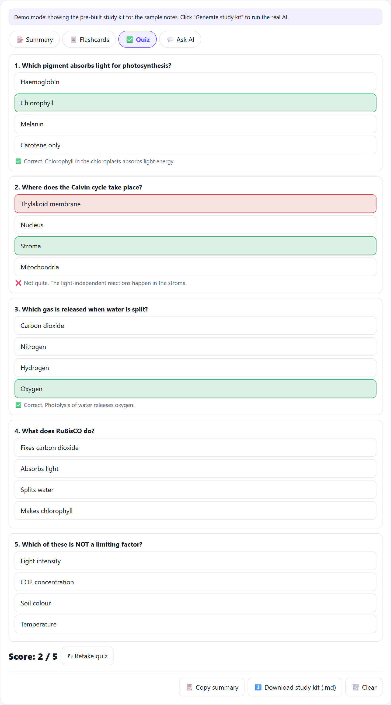
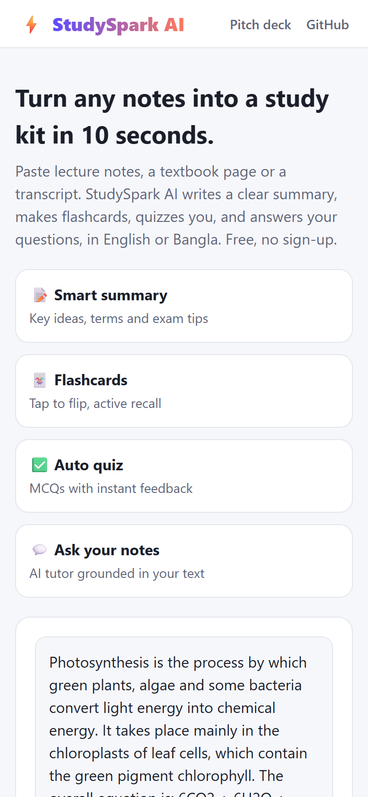

<div align="center">

# ⚡ StudySpark AI

**Turn any lecture notes into a complete study kit in about 10 seconds.**

Summary · Key terms · Exam tips · Flashcards · Auto-graded quiz · AI tutor chat, in **English or Bangla**.

[](https://aivietnam-aio-felixdoit.github.io/studyspark-ai/)
[](https://aivietnam-aio-felixdoit.github.io/studyspark-ai/?demo)
[](https://aivietnam-aio-felixdoit.github.io/studyspark-ai/deck.html)




</div>

## The problem

Students preparing for SSC, HSC and university exams study from long notes, PDFs and guidebooks. Turning those into summaries, flashcards and practice questions by hand takes hours, so most students just re-read, which is the least effective way to study. Private tutors are expensive and not available at midnight before an exam.

## The solution

Paste your notes (or upload a `.txt`), pick your level and language, and click **Generate**. StudySpark AI reads only your notes and builds:

| Feature | What you get |
|---|---|
| 📝 **Smart summary** | 5–7 key ideas, key terms with meanings, exam tips |
| 🃏 **Flashcards** | 8 tap-to-flip cards with shuffle, for active recall |
| ✅ **Auto quiz** | 5 MCQs with instant feedback, explanations, score and retake |
| 💬 **Ask AI** | A tutor chat that answers from your own notes |
| ⬇️ **Export** | Download the full kit as Markdown, or copy the summary |
| 💾 **Auto-save** | Your last study kit is restored when you come back |

## Screenshots

| Summary | Flashcards |
|---|---|
|  | <br> |

| Quiz with instant feedback | Mobile |
|---|---|
|  |  |

> Screenshots were taken in demo mode (`?demo`), which loads a pre-built study kit for the bundled sample notes.

## How it works

```
Notes ──▶ Structured prompt (level + language, grounded in notes only)
      ──▶ GPT-4o-mini via Puter.js
      ──▶ JSON {title, summary, keyTerms, examTips, flashcards, quiz}
      ──▶ Validate (retry once if invalid) ──▶ Interactive UI
```

- **No backend, no API key.** AI calls go straight from the browser through [Puter.js](https://puter.com), so the app is free to host and free to use. The first request may show a Puter sign-in popup.
- **Resilient demo.** If the AI service can't be reached while using the sample notes, the app falls back to a pre-built kit, so the product can always be shown.
- **Safe rendering.** All AI output is HTML-escaped before it is shown.

## Run locally

No build step. Clone the repo and open `index.html` in a browser:

```bash
git clone https://github.com/AIVIETNAM-AIO-felixdoit/studyspark-ai.git
cd studyspark-ai
start index.html   # Windows (macOS: open index.html)
```

## Project structure

```
index.html            # The whole app (UI + logic)
deck.html             # 5-slide pitch deck (print to PDF from the browser)
VIDEO_SCRIPT.md       # 2-minute English demo script
docs/screenshots/     # README images
```

## Roadmap

- PDF and photo upload (OCR for handwritten notes)
- Spaced-repetition reminders and progress tracking
- NCTB syllabus-aligned question banks

---

<div align="center">Built for <b>Ostad Presents YUNet AIgnite Buildathon 2026</b></div>
